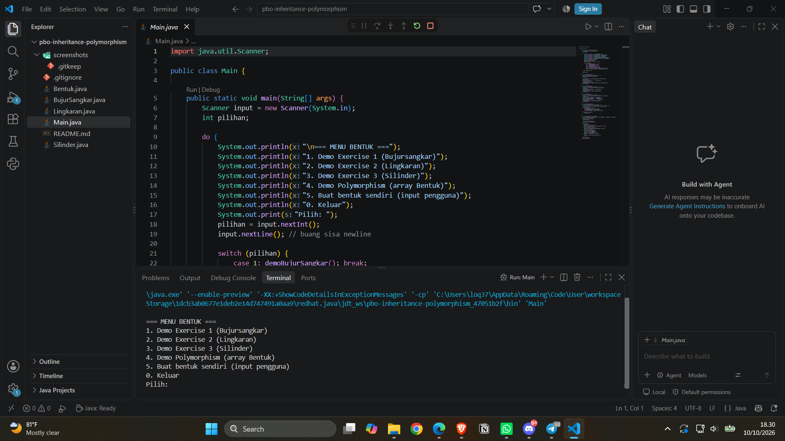
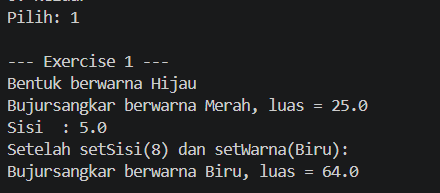
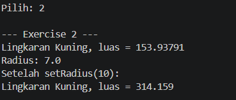
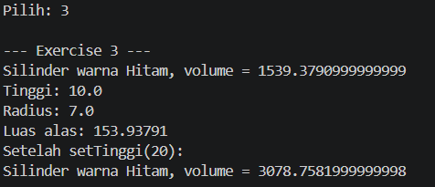
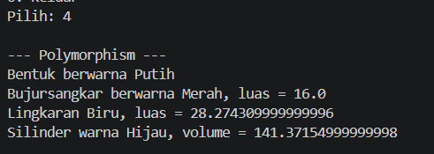

# Latihan PBO: Inheritance dan Polymorphism

**NIM:** F1D02510002
**Nama:** Ariyanta Nugraha Abdullah
**Mata kuliah:** Pemrograman Berorientasi Objek, Teknik Informatika, Universitas Mataram

## Struktur Kelas

```
Bentuk
 ├── BujurSangkar
 └── Lingkaran
      └── Silinder
```

| Kelas | Induk | Atribut | Method |
|---|---|---|---|
| Bentuk | - | warna | getWarna, setWarna, printInfo |
| BujurSangkar | Bentuk | sisi | getSisi, setSisi, hitungLuas, printInfo |
| Lingkaran | Bentuk | radius, PHI (konstanta) | getRadius, setRadius, hitungLuas, printInfo |
| Silinder | Lingkaran | tinggi | getTinggi, setTinggi, hitungVolume, printInfo |

## Penggunaan Encapsulation

Semua atribut (`warna`, `sisi`, `radius`, `tinggi`) dideklarasikan `private`, sehingga tidak bisa diakses langsung dari luar kelas. Nilainya dibaca dan diubah lewat method getter dan setter, misalnya `getWarna()` dan `setSisi()`. Subclass juga mengakses `warna` lewat `getWarna()`, bukan langsung.

## Penggunaan Inheritance

- `BujurSangkar` dan `Lingkaran` memakai `extends Bentuk` sehingga mewarisi atribut `warna` beserta getter dan setter-nya.
- `Silinder` memakai `extends Lingkaran` (multilevel), sehingga mewarisi `radius`, `getRadius()`, dan `hitungLuas()`. Volume dihitung dengan `hitungLuas() * tinggi`.
- Constructor subclass memanggil constructor induk dengan `super(...)`.

## Penggunaan Polymorphism

- **Overriding:** `printInfo()` di-override di setiap subclass dengan keluaran yang berbeda.
- **Dynamic binding:** di `Main.java` (menu 4), objek dari berbagai kelas disimpan dalam array bertipe `Bentuk[]`. Saat `printInfo()` dipanggil, Java menjalankan versi method sesuai objek aslinya.

## Cara Menjalankan

```bash
javac *.java
java Main
```

## Screenshot

### Menu utama


### Exercise 1 - Bujursangkar


### Exercise 2 - Lingkaran


### Exercise 3 - Silinder


### Polymorphism

